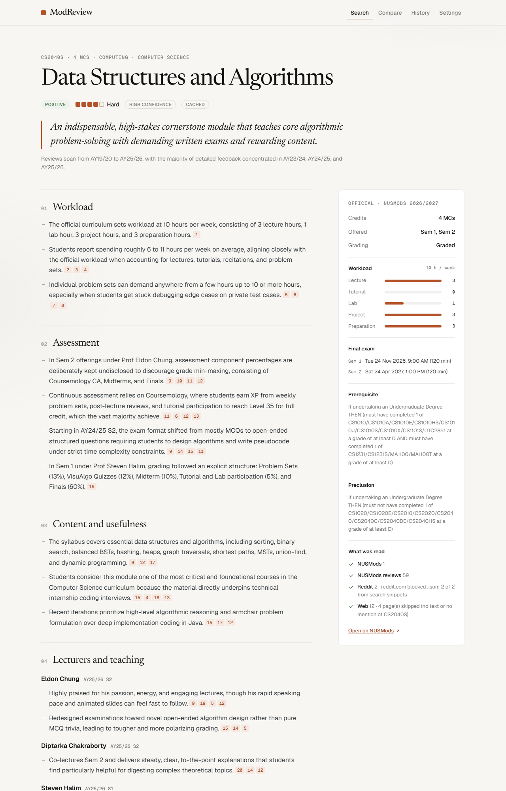
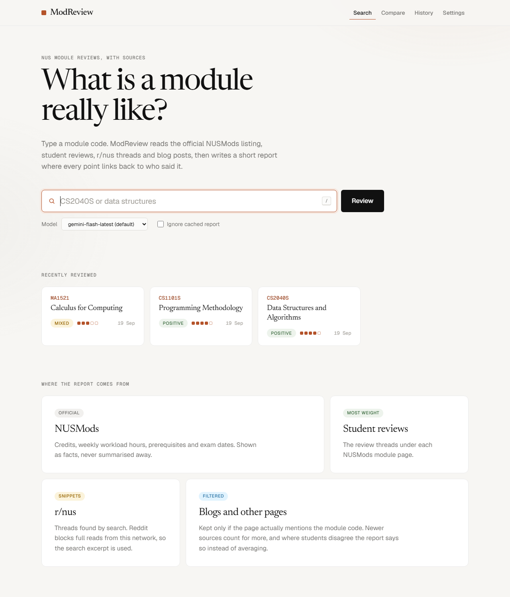
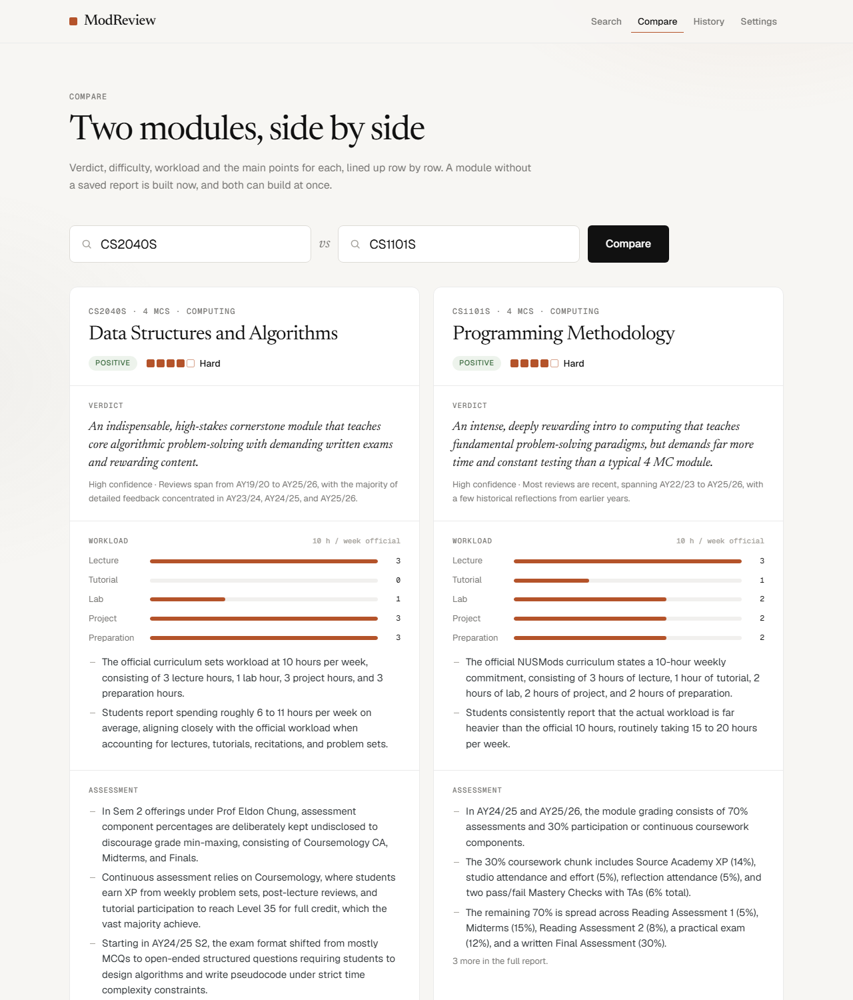
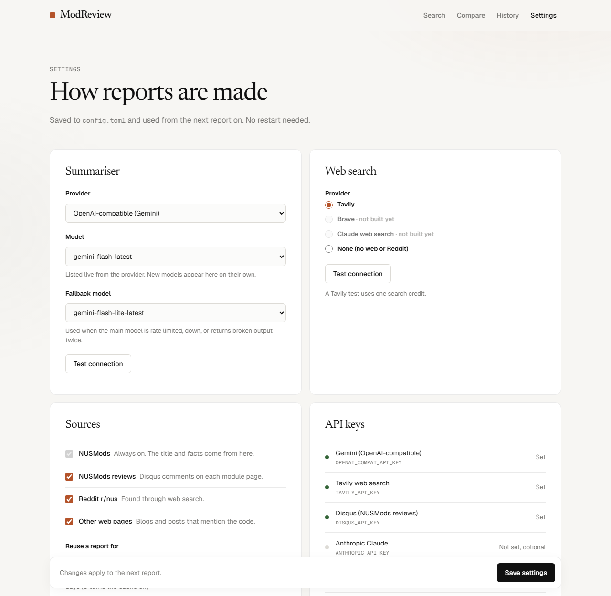
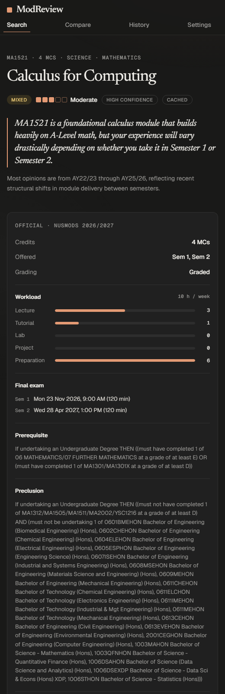

# ModReview

Type an NUS module code, get a structured, sourced review built from NUSMods, NUSMods student reviews (Disqus), r/nus and the wider web, summarised by an LLM. Runs only on your laptop at `http://127.0.0.1:8765`. Every API key it needs has a free tier.



| Search | Compare two modules |
|---|---|
|  |  |

| Settings | Dark mode, narrow window |
|---|---|
|  |  |

## Setup

1. Install [`uv`](https://docs.astral.sh/uv/) (`pip install uv` works), then run `uv sync`.
2. Get three free keys and paste them into `.env` (copy `.env.example` if `.env` does not exist):

| `.env` line | Service | Where to get it |
|---|---|---|
| `OPENAI_COMPAT_API_KEY` | Google AI Studio (Gemini, the default LLM) | aistudio.google.com/apikey. Do not set up billing: a project with billing but no credit stops working instead of using the free tier. |
| `TAVILY_API_KEY` | Tavily web search | app.tavily.com, 1,000 free credits a month (about 5 per report) |
| `DISQUS_API_KEY` | Disqus, public key | disqus.com/api/applications, create an app, copy the public "API Key" |

3. Start it:

```bash
uv run modreview
```

Flags: `--debug` (source counts and prompt size), `--port N`, `--no-browser`.

## Using it

- **Search**: type a code or part of a title and press Enter. Press `/` anywhere to jump to the search box. A report takes 20 to 40 seconds the first time and is reused for 14 days.
- **Report**: every point has small numbers; hover one to see the source, click it to jump to the source list. The right-hand panel is the official NUSMods data. Regenerate rebuilds the report; Download saves it as Markdown.
- **Settings**: change the model, fallback model, search provider, sources and cache lifetime. Changes apply to the next report without a restart. Keys are only shown as set or missing.
- **Compare**: pick two modules to see verdict, difficulty, official workload and the main points side by side. A module without a saved report is built on the spot; both can build at once. The Compare button on a report pre-fills it.
- **History**: every saved report, with download and delete.

## Terminal tools

```bash
uv run modreview fetch CS2040S -v
```

Runs the sources only and lists every document found. Uses no LLM.

```bash
uv run modreview review CS2040S
```

Runs the whole pipeline and prints the report JSON. A second run within 14 days comes from the cache; add `--force` to rebuild, `--model NAME` to try another model.

## Models

`config.toml` sets the model. The default is `gemini-flash-latest` with `gemini-flash-lite-latest` as the fallback, both through Gemini's OpenAI-compatible endpoint. The same provider works with any OpenAI-compatible server (Groq, OpenRouter, Ollama, LM Studio) by changing `OPENAI_COMPAT_BASE_URL` and the model name. Claude works too: set `[llm] provider = "anthropic"` and add `ANTHROPIC_API_KEY` (paid).

## Notes for this laptop

- TLS is re-signed by local security software, so uv uses the Windows certificate store (`[tool.uv] system-certs`) and the app builds its SSL context from the Windows store too.
- Reddit's public `.json` endpoint answers 403 here, so the Reddit source uses search snippets.

## Development

```bash
uv run pytest
```

```bash
uv run ruff check . && uv run ruff format --check .
```

See `PLAN.md` for the spec and `DECISIONS.md` for deviations.

Screenshots are taken with headless Chrome against the running app, for example:

```bash
chrome --headless=new --window-size=1280,2000 --blink-settings=preferredColorScheme=1 --screenshot=docs/screenshots/report.png http://127.0.0.1:8765/review/CS2040S
```
